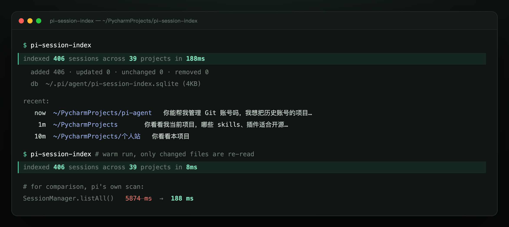

# pi-session-index

A SQLite index over pi's JSONL session files. Lists 406 sessions in **8 ms** instead of **5.9 s** — without touching pi.

  



## The problem

pi stores every session as a JSONL file under `~/.pi/agent/sessions/<encoded-cwd>/`. Any UI that shows a session list has to walk that directory:

```js
SessionManager.listAll()   // 406 sessions → 5874 ms
```

It gets worse with long sessions — one file here is 190 MB. Every sidebar refresh pays that cost, and it is paid twice (sessions + project grouping).

## What this does

It mirrors the metadata into SQLite next to the sessions and reads the list from there.

```
406 sessions, 39 projects
  first run   188 ms   (reads only the head of each file)
  warm run      8 ms   (only files whose mtime changed are re-read)
  full mode   5.9 s    (opt-in: also counts messages and grabs the last message)
```

The JSONL files stay the source of truth. The database is a disposable cache — delete it and it rebuilds itself.

## Install

```bash
npm i -g pi-session-index
```

Zero dependencies: it uses the built-in `node:sqlite` (Node 22.5+, experimental but stable enough — pi itself ships with Node 22+).

## CLI

```bash
pi-session-index                     # scan, then print stats + recent sessions
pi-session-index --list --limit 20   # newest sessions
pi-session-index --list --project ~/code/foo
pi-session-index --list --search 分页
pi-session-index --projects          # one row per project
pi-session-index --rebuild           # drop the index and rebuild
pi-session-index --full              # exact message counts (slow)
pi-session-index --watch 5           # rescan every 5s
```

```
$ pi-session-index
indexed 406 sessions across 39 projects in 188ms
  added 406 · updated 0 · unchanged 0 · removed 0
  db  ~/.pi/agent/pi-session-index.sqlite (4KB)
```

## API

```js
import { SessionIndex } from "pi-session-index";

const idx = new SessionIndex();            // agentDir defaults to PI_CODING_AGENT_DIR or ~/.pi/agent

await idx.scan();                          // fast: header + first user message
await idx.scan({ full: true });            // also message counts + last message

idx.list({ cwd, search, limit: 20 });      // newest first
idx.projects();                            // [{ cwd, count, latest }]
idx.stats();                               // { total, projects, messages, dbFile, dbBytes }
idx.close();
```

Point it at any agent directory:

```js
new SessionIndex({ agentDir: "/path/to/agent", dbFile: "/tmp/index.sqlite" });
```

## Fast vs full

| mode | reads | gives you | cost |
|---|---|---|---|
| fast (default) | first 32 KB of each file | cwd, first user message, mtime | ~0.5 ms/session |
| full | whole file | + exact message count, last message | seconds |

`updated` is the file mtime in both modes — that is what every sidebar sorts by, and it needs no parsing.

## Why not replace the storage?

Because you cannot, cleanly. pi hardcodes JSONL reads inside `SessionManager`; there is no storage extension point. Replacing it means patching `node_modules` (which is what a `patch-package` setup does), and that breaks on every pi release.

This project deliberately stays a **read-only index**: it never writes to `sessions/`, never patches pi, and cannot corrupt a conversation. If pi changes its session format, the worst case is a stale index — delete the `.sqlite` file.

If you do want real SQLite storage (TUI included), that is a different project with a different risk profile: a bug there loses conversations.

## Notes

- The index lives at `<agentDir>/pi-session-index.sqlite` (WAL). Add it to your backup exclusions if you back up `~/.pi/agent`.
- Renaming a project directory makes its sessions disappear from the index — pi has the same behaviour, because `cwd` is stored in each session header.
- Sessions are matched by file path; moving files triggers a re-read on the next scan.

## License

MIT
